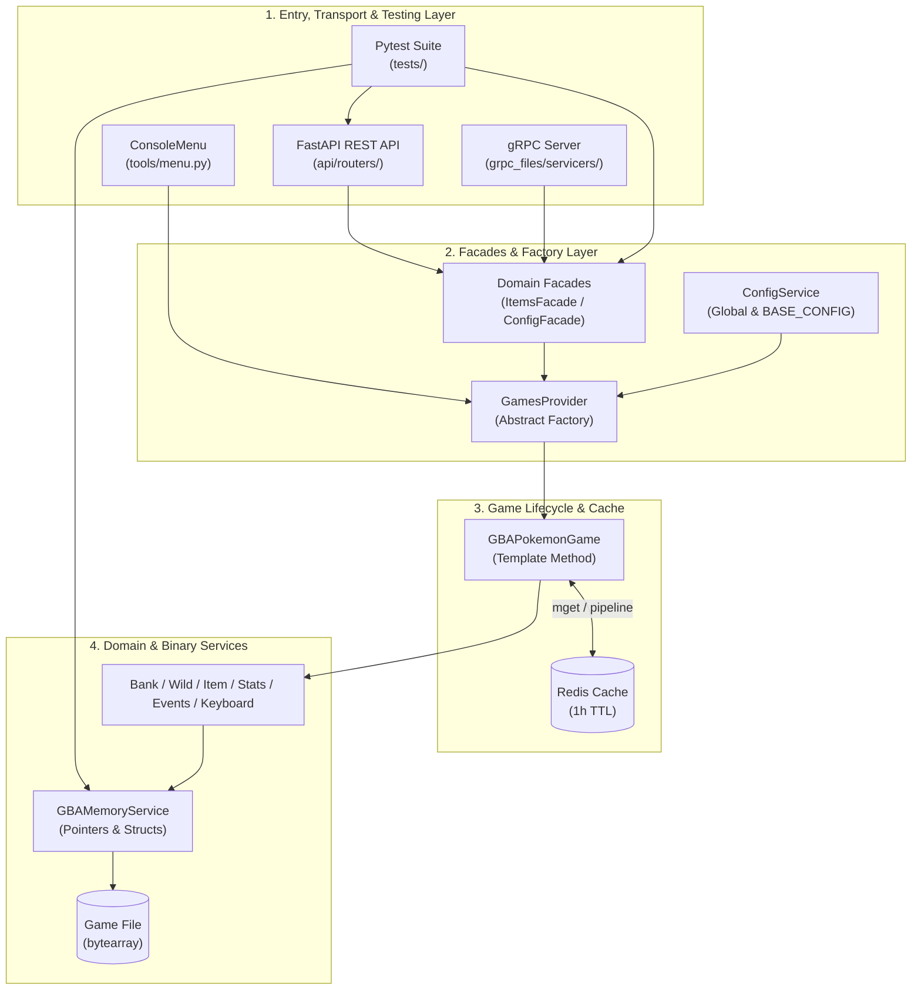

# Objective
This repo is a showcase of how I write clean, scalable, and maintainable Python code in my day-to-day work. Beyond being a fun CLI tool (with a GUI on the way) to randomize and customize classic consoles game files. I am starting with GBA through simple JSON configs, the main goal here is to let recruiters and engineering teams easily review my coding style, architecture decisions, and handling of low-level binary data, all kept simple to run and explore.

# 🎮 AdvanceR Nexus UpGen


[](https://opensource.org/licenses/MIT)

**AdvanceR Nexus UpGen** is a modular, extensible Python engine built to parse, reverse engineer and customize binary structures in classic game files. Designed to support multiple consoles and titles through declarative JSON configurations, the project kicks off with **Generation III Pokémon GBA** titles as its initial implementation. Featuring safe Pokéball item randomization via dynamic script repointing and full Spanish character support (`Ñ`, `ñ`, `¡`, `¿`) for in-game naming keyboards.

## 📑 Table of Contents
* [✨ Key Features](#-key-features)
* [🎯 Supported Games](#-supported-games)
* [🚀 Quick Start Guide](#-quick-start-guide)
  * [1. Create the Virtual Environment](#1-create-the-virtual-environment)
  * [2. Activate the Environment](#2-activate-the-environment)
  * [3. Execution](#3-execution)
    * [3.1 Interactive Console Menu (`ConsoleMenu`)](#31-interactive-console-menu-consolemenu)
    * [3.2 Adding a New Game](#32-adding-a-new-game)
* [📁 Project Structure](#-project-structure)
* [⚙️ Configuration Properties](#%EF%B8%8F-configuration-properties-config)
* [⚡ APIs (FastAPI & gRPC) & Redis Caching](#-apis-fastapi--grpc--redis-caching)
* [🏗️ Architecture & Design Patterns](#%EF%B8%8F-architecture--design-patterns)
  * [System Layers](#system-layers)
  * [Design Patterns Used](#design-patterns-used)

<h3 align="center">⚫ ⚫ ⚫ ⚫ ⚫ ⚫</h3>

## ✨ Key Features

* **Safe Pokéball Item Randomization (`EventsService` & `ItemService`):** Scans map events, inspects script opcodes to ensure the Pokéball holds an item rather than a starter Pokémon, generates new bytecode with a valid random item, and writes it into free space, while updating Game pointers.
* **Pokémon Base Stats & Difficulty-Based Wild Randomizer (`StatsService`, `BankService` & `EventsService`, `WildService` & `DifficultyService`):** Parses pokemon base stats, BST, types, abilities, and recursive evolution lines, then randomizes wild grass encounters using difficulty-scaled BST/evolution pools and dynamic level adjustments (`easy`, `normal`, `hard`, `inferno`).
* **Spanish UI & Internal Keyboard Customization (`{Console}KeyboardService`):** Restructures both visual layouts/spacings and logical character tables in game files, relocating `M`/`m` and inserting `Ñ`, `ñ`, `¡`, and `¿` without overflowing binary file boundaries.
* **Map Bank & Header Reverse Engineering (`BankService`):** Reads master binary pointer tables to reconstruct map hierarchies, map dimensions (`width x height`), decoded region names via game specific character tables (starting with Pokémon Gen III), and event counts.
* **Internationalization (`TranslationsService`):** Loads and flattens locale-specific JSON files (`ES_MX`, `EN_US`) for instant lookups.
* **Filterable Logging & Exception System (`LogService`):** Controls console output channels (`NONE`, `INFO`, `WARNING`, `ERROR`, `ERROR_AND_WARNING`, `ALL`) and raises dynamically mapped exceptions based on error keys.
* **Interactive Multi-Language Console Menu (`ConsoleMenu`):** Provides a responsive CLI interface (`tools/menu.py`) with real-time language switching (`EN_US` / `ES_MX`), screen clearing, and hotkey navigation (`ESC` to exit, `Backspace` / `0` to go back across steps).
* **Redis Binary Data Caching (`BaseGame` & `{Console}{Series}Game`):** Uses `redis.asyncio` to serialize and cache compiled map banks, species stats, and item tables for 1 hour (`ex=3600`), avoiding redundant file scans on consecutive runs.
* **REST FastAPI Layer & Domain Facades (`api/` & `facades/`):** Exposes HTTP endpoints (`POST /gba/pokemon/items`, `PATCH /config/language`) backed by domain facades (`ItemsFacade`, `ConfigFacade`), in-memory ROM validation, `asyncio.to_thread` offloading, HTTP-only `app_language` cookies, request-timing middleware, and centralized HTTP exception handlers.
* **Secure Async gRPC Server & Client (`grpc_files/`):** Exposes parsed game data (`GetAllItems` in `ItemsGrpcServicer`) over TLS (`grpc.aio.server`) using Protocol Buffers, delegating execution through `ItemsFacade` for both server-loaded and client-uploaded game files.
* **Automated Test Suite (`Pytest`):** Includes unit and integration tests under `tests/` (`test_memory.py`, `test_facades.py`, `test_config_router.py`) executable directly from `ConsoleMenu` (`4. Run Tests (Pytest)`) with optional `pytest-cov` coverage reporting.

## 🎯 Supported Games

Currently, the engine supports the following **Game Boy Advance (Gen III)** titles via dedicated JSON configuration profiles:

| Platform | Game Title | Version / Base | Status | Supported Features | Extended Features |
| :--- | :--- | :--- | :--- | :--- | :--- |
| **GBA** | **Pokémon FireRed** | USA (v1.0 / v1.1) | ✅ Ready | Item Randomizer, Spanish Keyboard Patch, Wild Pokemon Randomizer, FastAPI & gRPC Services | BST-Scaled Wild Randomizer |
| **GBA** | **Pokémon Radical Red** | v4.1 (FireRed Base) | ✅ Ready | Item Randomizer, Spanish Keyboard Patch, Wild Pokemon Randomizer, FastAPI & gRPC Services | BST-Scaled Wild Randomizer |
| **GBA** | **Pokémon Emerald** | USA | ✅ Ready | Item Randomizer, Spanish Keyboard Patch | — |
| **GBA** | **Pokémon Emerald Kaizo** | Emerald USA Base | ✅ Ready | Item Randomizer, Spanish Keyboard Patch | — |

> 💡 **Interested in Extended Features?**  
> Features like the **BST-Scaled Wild Randomizer** are available for you. If you'd like to get access or learn more about the project, feel free to reach out at the email **[mexican.dotnet.senior.engineer@gmail.com](mailto:mexican.dotnet.senior.engineer@gmail.com)**.

<h3 align="center">
  ⚫ ⚫ ⚫
    <a href="#-table-of-contents" title="Back to Table of Contents">⬆️</a>
  ⚫ ⚫ ⚫
</h3>

## 🚀 Quick Start Guide

To ensure maximum performance and speed when managing Python environments, this project utilizes **`uv`**. *(Requires Python 3.11+, a local Redis server on `127.0.0.1:6379`, and dependencies listed in `requirements.txt`).*

### 1. Create the Virtual Environment
Navigate to the root directory of the project and spin up an isolated virtual environment:
```bash
python -m uv venv 
```

### 2. Activate the Environment

Activate the virtual environment depending on your operating system:
* **macOS / Linux:**
  ```bash
  source .venv/bin/activate
  ```
* **Windows:**
  ```powershell
  .venv\Scripts\activate
  ```

### 3. Execution
1. Place your clean target game file in the root directory.
2. Install dependencies (`uv pip install -r requirements.txt`) and ensure your local Redis instance is running.
3. Adjust your main toggles in `config/global_config.json` (and optionally enable `USE_FEATURE_FLAGS` to fine-tune specific pipeline steps in `config/{console}/{series}/feature_flags.json`).
4. Run `python main.py` and use the interactive `ConsoleMenu` to switch languages, launch the Randomizer, start the secure gRPC server, or start the FastAPI server, run the gRPC test client, or execute the Pytest suite::

#### 3.1 Interactive Console Menu (`ConsoleMenu`)
Running `python main.py` launches an interactive, multi-language terminal menu (`tools/menu.py`):

* **Execution Flows:** Launch the **Generator & Randomizer**, start the **Secure Async gRPC Server**, or run the **gRPC Client Test** (using either the server-loaded game or uploading a custom game file).
* **Live Locale Switching:** Switch between `EN_US` and `ES_MX` on the fly before selecting a game or execution mode.
* **Keyboard Navigation:** Supports instant `ESC` exit from any screen and `0` / `Backspace` multi-level back navigation.

> 📖 For a complete breakdown of menu flows, keyboard shortcuts, and translation keys, see the [Interactive Console Menu Reference](./readme/menu.md).

#### 3.2 Adding a New Game
Adding support for a new title only requires updating a few files without touching the core engine:

1. **Register the Enum (`enums/games_enum.py`):** Add a new identifier to `AvailableGames` (e.g., `RUBY = 6`).
2. **Create the Game Profile (`config/{console}/{series}`):** Add a JSON configuration file defining the memory offsets, free space start, and feature flags for the new game, and register it in your game config mapping.
3. **Implement the Game Class (`games/{console}/{series}/`):** Create a new class inheriting from `{console}{series}Game` and override `_apply_game_specific_changes()` if the title requires custom logic.
4. **Register in the Factory (`games/core/{console}_{series}_core.py` & `games/core/games_provider.py`):** Map the new `AvailableGames` enum to its corresponding game class and factory provider.

<h3 align="center">
  ⚫ ⚫ ⚫
    <a href="#-table-of-contents" title="Back to Table of Contents">⬆️</a>
  ⚫ ⚫ ⚫
</h3>

## 📁 Project Structure

The repository is organized by architectural layers and platform domains so new consoles, games, and transport layers can scale independently:

* **`api/`** — RESTful FastAPI layer (`app.py`), domain routers (`items_router.py`, `config_router.py`), Pydantic schemas, form/cookie dependencies, timing middleware, and HTTP exceptions.
* **`facades/`** — Application orchestration layer (`BaseGameFacade`, `ItemsFacade`, `ConfigFacade`) that encapsulates ROM validation, config resolution, thread offloading (`asyncio.to_thread`), and cookie metadata.
* **`grpc_files/`** — Protocol Buffer contracts (`protos/items.proto`), compiled bindings (`generated/`), TLS credentials (`server.crt`, `server.key`), and async gRPC servicers (`servicers/items_servicer.py`).
* **`exceptions/`** — Shared domain exceptions (`DomainValidationError`, `ResourceNotFoundError`, `RomPreconditionError`) and FastAPI exception handlers used across both REST and gRPC transports.
* **`tests/` & `examples/`** — Unit and integration test suites (`tests/unit/`, `tests/integration/`) alongside executable FastAPI and gRPC client scripts (`examples/api/`, `examples/grpc/`).
* **`games/`** — Abstract Factory providers (`GamesProvider`, `{Console}{Series}CoreFactory`) and Template Method game classes (`BaseGame`, `GBAPokemonGame`, `FireRedGame`, `EmeraldGame`).
* **`services/`** — Core infrastructure (`ConfigService`, `FileService`, `LogService`, `ErrorService`, `TranslationsService`) and console/series binary parsers (`GBAMemoryService`, `BankService`, `EventsService`, `ItemService`, `StatsService`, `WildService`, `GBAKeyboardService`).
* **`config/` & `translations/`** — Declarative JSON game layouts (with recursive `BASE_CONFIG` inheritance), feature flags, and multi-language locale dictionaries (`EN_US`, `ES_MX`).
* **`models/`, `enums/` & `decorators/`** — Strongly typed `@dataclass` DTOs, domain enumerations, and feature-flag decorators (`@when_enabled`, `@skip_when_enabled`).
* **`tools/` & `main.py`** — Interactive multi-language CLI (`ConsoleMenu`) and application entry point routing between the Randomizer, gRPC server, and gRPC test clients.

> 📖 For a complete directory-by-directory and file-level breakdown, see the [Project Structure Reference](./readme/project_structure.md).

<h3 align="center">
  ⚫ ⚫ ⚫
    <a href="#-table-of-contents" title="Back to Table of Contents">⬆️</a>
  ⚫ ⚫ ⚫
</h3>

## ⚙️ Configuration Properties (`config/`)

The system unifies global settings, recursive `BASE_CONFIG` game hierarchies, difficulty profiles, and feature toggles at runtime via `ConfigService.load_global()` and `ConfigService.load_for_game()`, automatically parsing hexadecimal strings (`0x...`) into integers:

* **`config/global_config.json`:** Global behavior toggles (`RANDOMIZE_POKEBALLS_ITEMS`, `ADD_SPANISH_CHARS`, `RANDOMIZE_WILD_POKEMON`, `ONLY_DATABASE`, `CURRENT_LANGUAGE`, `LOG_TYPE`) plus infrastructure settings (`REDIS_HOST`, `REDIS_PORT`, `REDIS_DB`, `LANGUAGE_COOKIE_MAX_AGE`).
* **`config/{console}/{series}/{game}_config.json`:** Title-specific pointer offsets, table sizes, and free-space boundaries. See the [FireRed Configuration Example](./readme/gba/pokemon/fire_red.md).
* **`config/{console}/{series}/feature_flags.json`:** Optional granular pipeline toggles (`ALLOCATE_BANKS`, `ALLOCATE_MAPS`, `MAPS_EVENTS`).

> 📖 For the full list of global keys and transient runtime state (`game_file`, `free_space_offset`), see the [Configuration Properties Reference](./readme/configuration.md).

<h3 align="center">
  ⚫ ⚫ ⚫
    <a href="#-table-of-contents" title="Back to Table of Contents">⬆️</a>
  ⚫ ⚫ ⚫
</h3>

## ⚡ APIs (FastAPI & gRPC) & Redis Caching

To support external clients (such as upcoming web or desktop GUIs) and eliminate redundant binary scans across consecutive runs, **AdvanceR Nexus UpGen** provides dual transport layers backed by shared domain facades and Redis caching:

* **RESTful FastAPI Layer (`api/` & `facades/`):** Exposes HTTP/JSON endpoints (`POST /gba/pokemon/items`, `PATCH /config/language`) with form/cookie parsing (`app_language`), request-timing middleware (`X-Process-Time`), and centralized domain-to-HTTP exception handlers.
* **Secure Async gRPC (`grpc_files/`):** Exposes parsed binary structures (`GetAllItems` in `ItemsGrpcServicer`) over **HTTP/2 + TLS** (`grpc.aio.server`), delegating execution through `ItemsFacade` for both server-loaded and client-uploaded game files.
* **Redis Caching (`redis.asyncio`):** Serializes and caches compiled map banks, species stats, and item tables (`game:{GAME_NAME}:*`) with a **1-hour TTL (`ex=3600`)**, reconstructing typed `@dataclass` models via `load_from_json()`.

> 📖 For REST endpoints, Protobuf contracts, TLS setup, and cache deserialization details, see the [APIs & Redis Architecture Reference](./readme/apis_redis.md).


<h3 align="center">
  ⚫ ⚫ ⚫
    <a href="#-table-of-contents" title="Back to Table of Contents">⬆️</a>
  ⚫ ⚫ ⚫
</h3>

## 🏗️ Architecture & Design Patterns

When refactoring this codebase from procedural helper scripts into an extensible engine, I designed a **Layered Service-Oriented Architecture** with strict separation of concerns, keeping low-level binary manipulation completely decoupled from console and game specific rules.



### System Layers
1. **Entry, CLI & Transport Layer (`main.py`, `tools/`, `api/`, `grcp_files/`, `settings.py`):** Loads global and game-specific JSON configs (`init_global_config` / `init_game_config`), drives user interaction through `ConsoleMenu`, and exposes game services via TLS-secured `grpc.aio` endpoints or local execution.
2. **Core Factory & Domain Layer (`games/core/`, `games/`):** Uses `GamesProvider` and `{Console}{Series}CoreFactory` to assemble platform service families, while `BaseGame`, `{Console}Game`, and `{Console}{Series}Game` define the game execution lifecycle for concrete titles (`FireRedGame`, `EmeraldGame`).
3. **Service Layer (`services/`):** Encapsulates all business logic and binary operations split by technical domain (`{Console}MemoryService`, `BankService`, `EventsService`, `ItemService`, `StatsService`, `{Console}KeyboardService`) alongside cross-cutting infrastructure services (`ConfigService`, `LogService`, `TranslationsService`, `FileService`).
4. **Models & Data Layer (`models/`, `enums/`, `helpers/`):** Provides strongly typed data structures (`@dataclass`), enumerations, and hexadecimal lookup tables free of side effects.

<h3 align="center">
  ⚫ ⚫ ⚫
    <a href="#-table-of-contents" title="Back to Table of Contents">⬆️</a>
  ⚫ ⚫ ⚫
</h3>

### Design Patterns Used

* **Abstract Factory & Provider (`games/core/`):** Decouples game instantiation and platform service assembly from `main.py` (`GamesProvider`, `GBAPokemonCoreFactory`).
* **Template Method (`games/`):** Defines the shared async execution pipeline in `GBAPokemonGame.process_game()` while delegating title-specific hooks to subclasses (`FireRedGame`, `EmeraldGame`).
* **Constructor Dependency Injection (`services/`):** Injects shared services and the in-memory `bytearray` game buffer without tight coupling.
* **Data Transfer Object (`models/`):** Represents parsed banks, maps, events, stats, and items as strongly typed `@dataclass` payloads.
* **Strategy / Declarative Patching (`UIKeyboardPatch`):** Drives keyboard layout transformations from declarative data structures rather than hardcoded indices.
* **Custom Decorators & Metaprogramming (`decorators/`):** Controls pipeline steps via config flags (`@when_enabled`, `@skip_when_enabled`) and generates `IntEnum` definitions dynamically (`@keys_from_str`).
* **Facade (`facades/`):** Simplifies ROM validation, in-memory loading, thread offloading, and configuration responses behind clean interfaces (`ItemsFacade`, `ConfigFacade`) shared by both FastAPI and gRPC

> 📖 For detailed locations, rationale, and architectural trade-offs for each pattern, see the [Design Patterns & Architecture Deep Dive](./readme/architecture.md).
